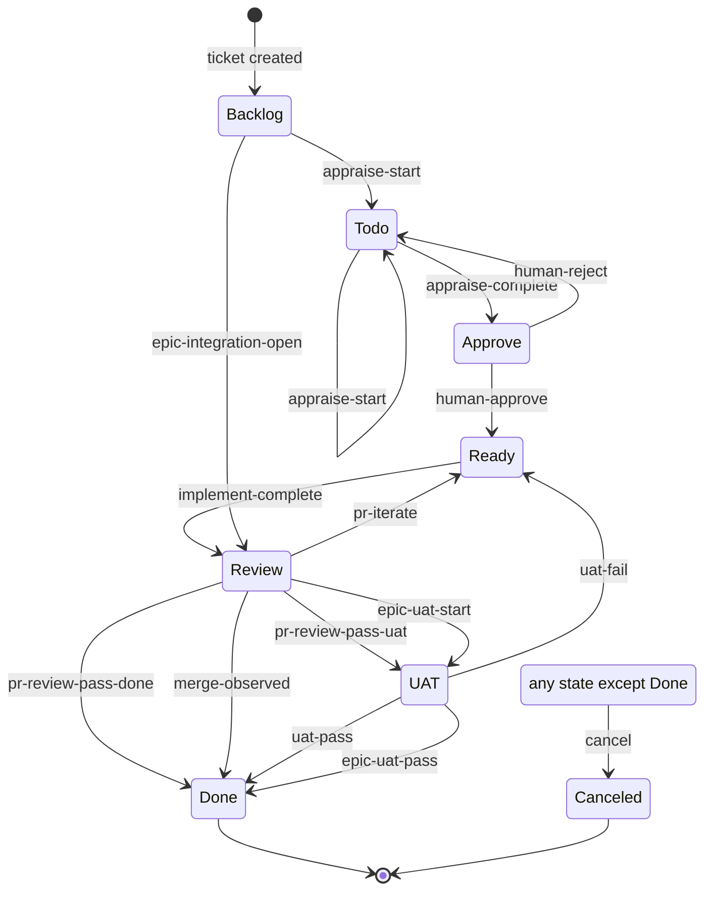

# ticket-auto-pipeline

Fully autonomous Linear ticket pipeline as a Claude Code plugin. Appraise, implement, verify, and merge — zero user input required.

## Install

```bash
# Add the marketplace first (one-time)
claude plugin marketplace add willard-pro/claude-plugins

# Install the plugin
claude plugin install ticket-auto-pipeline@willard-pro-claude-plugins
```

Verify everything is wired up — from within Claude Code:

```
/ticket-env-check
```

This validates all required env vars (`LINEAR_API_KEY`, `GITHUB_PERSONAL_ACCESS_TOKEN`/`GH_TOKEN`, `ANTHROPIC_AUTH_TOKEN`) and CLAUDE.md fields. Fix any failures before running pipeline commands.

## Quickstart

After install, get through these steps before running your first pipeline:

**1. Set environment variables** in `~/.claude/settings.local.json`:

```json
{
  "env": {
    "LINEAR_API_KEY": "lin_api_...",
    "GITHUB_PERSONAL_ACCESS_TOKEN": "ghp_...",
    "ANTHROPIC_AUTH_TOKEN": "sk-ant-..."
  }
}
```

**2. Configure MCP servers** in `~/.claude.json` (see [MCP Config](#required-mcp-servers) below for full examples).

**3. Set project fields** in your working directory's `CLAUDE.md`:

```markdown
# CLAUDE.md
REPOS_ROOT: /home/you/repos
LOCAL_URL: http://localhost:5173
UAT_URL: https://staging.example.com
```

`REPOS_ROOT` must **also** be set as an environment variable (e.g. in the `env` block of `~/.claude/settings.local.json`). `/ticket-auto` reads it from `CLAUDE.md` and exports it for its phases, but the standalone `/ticket-approve` / `/ticket-reject` commands and the local manifest layer (`lib/manifest-read.sh`) read only the environment and fail with "could not make … manifest-addressable" when it is missing — `/ticket-env-check` does not catch this.

**4. Validate the full setup** from within Claude Code:

```
/ticket-env-check
```

Then confirm your Linear team's states and labels match the state machine:

```bash
bash "$(find ~/.claude/plugins/cache/willard-pro-claude-plugins/ticket-auto-pipeline \
  -name validate-linear-config.sh -type f | sort -V | tail -1)"
```

(Working from a clone of this repo instead? The script is at `ticket-auto-pipeline/skills/ticket-flow/validate-linear-config.sh`.)

**5. Run your first pipeline:**

```
/ticket-auto <ticket-id>
```

Use `--auto` or `--semi-auto` for reduced gating (see [Autonomy Modes](#ticket-auto--autonomy-modes)).

## Ticket Templates

The pipeline extracts structured data from Linear ticket descriptions at multiple phases. Poorly written tickets cause the pipeline to guess — increasing appraise time, triggering false verification passes, and burning extra LLM cycles recovering information that should have been in the ticket.

The [`templates/`](templates/) directory provides four ready-to-copy templates for creating tickets that give the pipeline exactly what it needs:

| Template | Label | Use when |
|----------|-------|----------|
| [`bug.md`](templates/bug.md) | `bug` | Something that worked before is now broken |
| [`feature.md`](templates/feature.md) | `feature` | Net-new capability that doesn't exist yet |
| [`improvement.md`](templates/improvement.md) | `improvement` | Improving or extending an existing feature |
| [`security.md`](templates/security.md) | `security` | Vulnerability, auth bypass, or data exposure |

**Why it matters for the pipeline:**

| Template field | Pipeline phase that reads it | Without it |
|----------------|------------------------------|------------|
| Atomic acceptance criteria | `ticket-verify` — one criterion = one browser assertion | Pipeline expands vague phrases at verify time; risks false passes |
| Test User | `ticket-verify` pre-flight (Step 1.7a) | Falls back through 4 sources; may pick the wrong user |
| Navigation Path (click-by-click) | `ticket-verify` — drives Playwright navigation | Direct URL navigation breaks Angular session state |
| Scope table | `ticket-appraise` — fires multi-service / cross-layer complexity axes | Complexity may be underscored; simple-fix artifact generated for a complex ticket |
| Test Data Prerequisites | `ticket-verify` pre-flight gate | Verify runs against missing data and fails with misleading errors |

Copy the relevant template into the Linear ticket description before running `/ticket-auto`. The pipeline will parse the structure without needing to infer it.

## Required Environment

| Variable | Purpose |
|----------|---------|
| `LINEAR_API_KEY` | Linear API authentication |
| `GITHUB_PERSONAL_ACCESS_TOKEN` (or `GH_TOKEN`) | GitHub CLI + PR operations |
| `ANTHROPIC_AUTH_TOKEN` | Claude API key |

Optional:

| Variable | Purpose |
|----------|---------|
| `ANTHROPIC_BASE_URL` | Custom API endpoint |
| `ANTHROPIC_MODEL` / `ANTHROPIC_DEFAULT_OPUS_MODEL` etc. | Model overrides |
| `GIT_AUTHOR_NAME` / `GIT_AUTHOR_EMAIL` | Commit authorship |
| `UAT_URL` | UAT environment URL for verification |
| `REPOS_ROOT` | Workspace root. Also declared in `CLAUDE.md` (below), but **must be exported in the environment too** for `/ticket-approve`, `/ticket-reject` and anything else that reads the local manifest layer (`lib/manifest-read.sh` reads only the environment — no `CLAUDE.md` fallback, no default). `/ticket-auto` exports it for its own phases. |
| `TICKET_AUTONOMY` | Default autonomy mode — `manual` (default), `auto`, or `semi-auto` |
| `TICKET_RECORD` | `true` records every ticket as if `--record` were passed (only warns when `RECORD_ALLOWED` is unset) |
| `RECORD_DISABLE` | `true` turns recording off for a ticket whose log already has it on |
| `RECORD_ALLOWED` | Also a `CLAUDE.md` field. Environments `--record` may capture: `local` and/or `uat`, comma-separated. **Name only environments holding synthetic data.** `--record` is refused without it |
| `RECORD_UAT_SYNTHETIC` | Also a `CLAUDE.md` field. Must be `true` for `uat` in `RECORD_ALLOWED` to count |
| `RECORD_BOARD_URL` | Also a `CLAUDE.md` field. The Linear project or view URL the board recorder screenshots. See [Recording a Run](#recording-a-run---record) for the setup |

Fleet controller configuration (all optional, safe defaults):

| Variable | Default | Description |
|----------|---------|-------------|
| `FLEET_POLL_INTERVAL` | 30 | Seconds between monitor mode cycles |
| `FLEET_STALL_WARN_SECS` | 300 | Stale heartbeat threshold for WARN |
| `FLEET_STALL_KILL_SECS` | 900 | Stale heartbeat threshold for KILL |
| `FLEET_STALL_RESTART_SECS` | 1800 | Stale heartbeat threshold for KILL+RESTART |
| `FLEET_ABANDON_WARN_HOURS` | 1 | Abandonment threshold for WARN |
| `FLEET_ABANDON_KILL_HOURS` | 4 | Abandonment threshold for KILL+RESTART |
| `FLEET_MAX_RESTARTS` | 2 | Max automatic restarts before giving up |
| `FLEET_AUTO_RESTART` | false | Must be `true` to enable automatic restarts |
| `FLEET_DRY_RUN` | false | When `true`, interventions are logged not executed |
| `FLEET_MAX_LOG_AGE_HOURS` | (unset) | Skip pipeline logs older than N hours (unset = scan all) |

## Required MCP Servers

The pipeline requires three MCP servers configured in `~/.claude.json` (or `.claude.json` in your project root):

```json
{
  "mcpServers": {
    "linear-server": {
      "command": "npx",
      "args": ["-y", "@linear/mcp-server"],
      "env": {
        "LINEAR_API_KEY": "${LINEAR_API_KEY}"
      }
    },
    "playwright": {
      "command": "npx",
      "args": ["-y", "@anthropic/mcp-server-playwright"]
    },
    "github": {
      "command": "npx",
      "args": ["-y", "@anthropic/github-mcp-server"],
      "env": {
        "GITHUB_PERSONAL_ACCESS_TOKEN": "${GITHUB_PERSONAL_ACCESS_TOKEN}"
      }
    }
  }
}
```

| Server | Purpose |
|--------|---------|
| `linear-server` | Linear ticket operations (issue reads, state/label mutations) |
| `playwright` | Browser automation for UAT verification |
| `github` | PR management, code review, and CI checks |

Restart Claude Code after adding MCP servers.

## Slash Commands

### Core Pipeline

| Command | What it does |
|---------|-------------|
| `/ticket-auto <id>` | Full autonomous pipeline. `--record` also keeps pictures of the run — see [Recording a Run](#recording-a-run---record) |
| `/ticket-appraise <id>` | Investigation + complexity analysis |
| `/ticket-appraise-exec <id>` | Artifact creation (simple-fix.md or openspec change) |
| `/ticket-implement <id>` | Implementation workflow |
| `/ticket-verify <id>` | Post-implementation Playwright UAT |
| `/ticket-pr-review <id>` | PR code review pass |
| `/ticket-pr-iterate <id>` | Iteration on PR feedback |
| `/ticket-prescan [path]` | Build durable agent-knowledge docs for a repo |
| `/ticket-record-stitch <id>... [--out FILE]` | Build a video from the recordings of tickets that ran with `--record` (needs `ffmpeg`). `--clip <id>` builds one ticket's verification clip. |

### Human Decisions

Approval and rejection are facts in the ticket's local manifest (tracker-approval-by-script). Adding or removing an `approved` label in Linear, or moving the card, has no effect — the Linear column and labels are a display-only projection.

| Command | What it does |
|---------|-------------|
| `/ticket-approve <id>` | Approve a ticket held at the gate: fires `human-approve` (`Approve → Ready`), records `approved: true` / `approval_provenance: human` in the manifest, clears a `needs-info` flag. Re-run `/ticket-auto <id>` afterwards. |
| `/ticket-reject <id>` | Reject the plan: fires `human-reject` (`Approve → Todo`) and clears the approval fact, so the ticket is re-appraised. |
| `/ticket-cancel <id> --reason "<why>"` | Retire a ticket nobody will finish: fires `cancel` (any state except Done → `Canceled`), clears the four projected labels and the approval, and writes `META\|cancel` and `META\|outcome\|info\|cancelled: …` to the pipeline log. Canceled is final. Tickets blocked by it are **not** released; the command lists them. Refused while a worker for the ticket is alive (`--force` overrides). Do not set Canceled by hand in Linear. |
| Answer Open Questions | Reply in the ticket's Linear comment thread before approving; the gate-reconcile agent folds the answers into the plan on the next run. |
| `bash ~/.claude/skills/lib/adversarial-override.sh [--log-file F] <id> --reason "<why>"` | Accept a plan the adversarial review BLOCKED without another review round. Writes `META\|adversarial-override\|info\|reason=…`, an `EXEC\|adversarial-review\|done\|WARNINGS — HUMAN OVERRIDE: …` line (so resume continues) and a WARN `adversarial_review` verifier-result (so `flow.sh`'s verdict gate does not refuse `pr-review-pass-*` later). Run it from a plain terminal: it refuses when `CLAUDE_CODE_SESSION_ID`, `FLEET_WORKER_PID` or `FLEET_GENERATION` is set (exit 4), needs a non-empty reason (exit 2), and refuses when no adversarial BLOCK is live (exit 5). The log defaults to `$FLEET_PIPELINE_LOG_DIR` (else `./logs`)`/<id>-pipeline.log`. A hand-written `done\|WARNINGS` line no longer clears the verdict gate ([#610](https://github.com/willard-pro/claude-plugins/issues/610)). Re-run `/ticket-auto <id>` afterwards. |
| `bash ~/.claude/skills/lib/regression-ack.sh <id> [--note "<why>"]` | Acknowledge a ticket's Regression Risk (the `## ⚠️ Regression Risk` section of notes.md, written when the plan touches code a prior fix touched). The pipeline records every version of that section it sees in the ticket manifest, and implementation holds until a person has acknowledged every recorded version. The script prints each unacknowledged version with a risk id (also versions notes.md no longer shows, from the recorded text) and asks you to type the last id back; only then does it append `regression_acks` entries (`risk`, `provenance: human`, `by`, `at`, `note`) and write `gate-released` outbox events. So a changed section holds again, a deleted or renamed section still holds, and putting an old acknowledged text back does not clear a newer version. Run it from the tickets root, in an interactive terminal, with `REPOS_ROOT` exported. It refuses (exit 4) when `CLAUDE_CODE_SESSION_ID`, `FLEET_WORKER_PID` or `FLEET_GENERATION` is set, and when there is no terminal to ask on (the answer is read from `/dev/tty`, never stdin), so a pipeline agent or a Claude Code Bash call cannot run it. It refuses (exit 7) when the section holds control or invisible characters, which could hide text on your terminal: have the section rewritten as plain text; an earlier recorded version with such characters is then shown escaped under a warning. Limits: this is not a sandbox. An agent that allocates its own pseudo-terminal, or writes the manifest file directly, gets past it, and asking an agent to do so hands it your decision. Editing notes.md acknowledges nothing ([#771](https://github.com/willard-pro/claude-plugins/issues/771)). Re-run `/ticket-auto <id>` afterwards. |

The two slash commands need `REPOS_ROOT` in the environment (see [Required Environment](#required-environment)).

### Flow Control

| Command | What it does |
|---------|-------------|
| `/ticket-flow <id> <trigger>` | State/label mutation executor (wraps `flow.sh`) |
| `/ticket-setup <id>` | Ticket workspace scaffolding |
| `/ticket-retro [id]` | Pipeline failure analysis |
| `/ticket-create` | Log one new ticket through the standard path — template body, readiness check, duplicate check, `_adhoc` manifest. A `PreToolUse` guard denies direct Linear creates and points here (`TICKET_CREATE_GUARD=off` in the Claude Code session environment to bypass — a prefix inside the command has no effect). |

### Monitoring & Fleet Control

| Command | What it does |
|---------|-------------|
| `/ticket-overseer` | Pipeline queue dashboard report (human-facing) |

Fleet monitoring now lives in the separate [`fleet-controller`](../fleet-controller/README.md) plugin — `/fleet-controller status`, `monitor`, `intervene`, `dispatch`, `feedback`. The old `/ticket-fleet-controller` command has been removed.

### Supporting

`ticket-audit`, `ticket-audit-exec`, `ticket-batch-appraise`, `ticket-batch-verify`, `ticket-critique`, `ticket-detect-resume`, `ticket-reproduce`, `wiki-maintenance`, `nav-hints`, `app-knowledge`.

## Recording a Run (`--record`)

`/ticket-auto <id> --record` keeps pictures of one ticket's run, and `/ticket-record-stitch` turns them into a short video: the card moving on the board, the feature working in the app, the card reaching Done. Recording is off unless you turn it on, and it is extra output only: it never changes a verdict, a gate decision or a route.

### What is recorded

| Recorded | Not recorded |
|---|---|
| **App frames**: in browser-mode VERIFY, one 1280×800 screenshot per settled step (first page, the page after login, each navigation, each Verification Plan step, each criterion's assertion point) | Any page with a typed password in a form (the login form, a change-password form). The video jumps from the page before login to the page after it |
| **Board frames**: one screenshot of the card's column each time the card moves, taken by the `recorder` board driver once the card is seen in its new column | Build-only and live-backend VERIFY (there is no browser), and REPRODUCE |
| | APPRAISE, IMPLEMENT and PR-REVIEW |
| | Any page whose origin is not `LOCAL_URL` or `UAT_URL`, or whose environment `RECORD_ALLOWED` does not allow |

Frames are screenshots shown for a fixed time (app 1.5 s, board 2 s), not live video.

### Synthetic data only

A recording is made to be shown to other people. **Record only environments that hold synthetic data.**

- `RECORD_ALLOWED` names the environments that may be recorded: `local`, `uat`, or `local,uat`. Any other name makes the field invalid.
- `uat` counts only when `RECORD_UAT_SYNTHETIC=true` is also set. That second field is your statement that UAT holds no real data.
- An explicit `--record` is refused (exit 1, nothing written) when `RECORD_ALLOWED` is unset, invalid or allows nothing. `RECORD_ALLOWED=uat` without `RECORD_UAT_SYNTHETIC=true` allows nothing, so it refuses `--record`.
- `TICKET_RECORD=true` (a fleet- or project-wide default) only warns in that case and records nothing, so it can never stall fleetd.

The rule is enforced in bash, not by the agent: `record.sh` checks the page URL of every screenshot against `LOCAL_URL` / `UAT_URL` and deletes a screenshot it may not keep, and the stitch checks every frame again against the `RECORD_ALLOWED` in force when you stitch.

### Setup (once per tickets root)

App frames need only step 3. Board frames need all of it.

1. **Create a dedicated Linear user** with read-only (or guest) access to the one demo project. Step 4 saves a browser session, and that session is a full login for whoever logged in. Never use your own account.

2. **Install Playwright under the tickets root.** It is not bundled with the plugin; it needs Node.

   ```bash
   mkdir -p "$REPOS_ROOT/.ticket-auto/record" && cd "$REPOS_ROOT/.ticket-auto/record"
   npm init -y                        # keeps npm in this directory; without a package.json it may install into a parent
   npm i playwright
   npx playwright install chromium    # the browser itself goes to ~/.cache/ms-playwright (per user)
   ```

3. **Add the fields to the project `CLAUDE.md`** (the one at `$REPOS_ROOT/CLAUDE.md`):

   ```
   RECORD_ALLOWED = local
   RECORD_BOARD_URL = https://linear.app/<workspace>/project/<project-slug>/...
   ```

   `RECORD_BOARD_URL` must start with `https://linear.app/` and have `/project/` or `/view/` in its path; anything else is refused and no browser is started for it. Open it as a **board** layout, grouped by status, filtered to the demo project, with the pipeline's columns visible (not hidden or collapsed): `Todo`, `Approve`, `Ready`, `Review`, `UAT`, `Done`, and `Canceled` if a cancel is to be shown.

4. **Save the Linear session**, from the tickets root. The driver is not synced to `~/.claude/skills/lib/`, so find it in the installed plugin:

   ```bash
   source ~/.claude/skills/lib/plugin-cache.sh
   RECORDER="$(tap_cache_find ticket-auto-pipeline lib/board-drivers/recorder.sh)"
   bash "$RECORDER" login
   ```

   A browser window opens on `RECORD_BOARD_URL`. Log in as the dedicated user, wait for the board, then press Enter in the terminal. The session is saved to `$REPOS_ROOT/.ticket-auto/record/linear-session.json` (mode 0600, directory 0700, with a `.gitignore` of `*` beside it). The three commands read `REPOS_ROOT` from the environment, else from `./CLAUDE.md`.

   On a host with no display, log in on a machine that has one and pipe the file over:

   ```bash
   ssh <host> 'cd <tickets root> && bash <path to recorder.sh> import' < linear-session.json
   ```

   `bash "$RECORDER" check` prints one word: `ok`, `browser-missing`, `no-session`, `expired`, `timeout` or `error`.

5. **Set `FLEET_BOARD_DRIVERS=linear,recorder`**, in that order, in the Claude Code session environment (the `env` block of `settings.local.json`) **and** in fleetd's environment. The recorder waits for `linear` to have moved the card; listed first, or not listed, it captures no board frames. fleetd's environment also needs `REPOS_ROOT`, which the driver reads from the environment only.

6. **Run `/ticket-env-check`.** When `RECORD_ALLOWED` is set it adds eight rows, each `ok` or `warn` (a recording problem is never counted as an environment failure). It starts a headless browser once, so it can take up to 30 s.

   | Row | `ok` means |
   |---|---|
   | `RECORD_ALLOWED` | the field is valid and allows at least one environment |
   | `RECORD_BOARD_DRIVERS` | `recorder` is listed after `linear` |
   | `RECORD_BOARD_URL` | the URL has the required shape (the URL itself is not printed) |
   | `RECORD_FFMPEG` | `ffmpeg` is on `PATH` |
   | `RECORD_BROWSER` | Node, Playwright and Chromium start |
   | `RECORD_SESSION` | the saved session still gets past Linear's login page |
   | `RECORD_SESSION_MODE` | the session file is 0600 and its directory 0700 |
   | `RECORD_SESSION_IGNORED` | git would not track the session file |

### Record and stitch

```
/ticket-auto <id> --record
/ticket-record-stitch <id>
```

Recording is noted once in the ticket's pipeline log, so a resume without `--record` keeps recording. Run the stitch from the tickets root at any time; it reads only what is on disk and can be re-run.

| Command | Output |
|---|---|
| `/ticket-record-stitch <id>... [--out FILE] [--order given]` | `./recording-<id>.mp4` (`./recording-<id>-plus<N>.mp4` for several tickets): per ticket a title card, then its board and app frames in time order. Only the latest VERIFY attempt is shown. Tickets come in the order of their first frame; `--order given` keeps the order typed |
| `/ticket-record-stitch --clip <id>` | `<ticket dir>/artifacts/recordings/<id>-verify.mp4`: the latest VERIFY attempt's app frames only |

The stitch needs `ffmpeg` (with `libx264`). So does `make test` in this repository: the render tests fail, not skip, without `ffmpeg` and `ffprobe`.

### Settings

| Variable | Default | Purpose |
|---|---|---|
| `RECORD_SHOT_TIMEOUT` | 25 | Seconds before a board screenshot is killed. 1–55; any other value means 25. The screenshot script stops itself after 20 s, so this is a backstop |
| `RECORD_SHOT_DEBUG` | (unset) | `1` prints the browser's error text when you run `recorder.sh login` or `check` by hand. Never the session |
| `RECORD_DISABLE` | (unset) | `true` turns recording off for a ticket whose log has it on |
| `RECORD_STITCH_TIMEOUT` | 300 | Seconds one stitch render may take |

### When a board frame is missing

Every board frame that was not saved has a line in `<ticket dir>/artifacts/recordings/manifest.jsonl` with a `reason`. The run itself is not affected.

| `reason` | Meaning | Fix |
|---|---|---|
| `superseded` | A later move of the same card was already waiting; only the last one is shot | None needed |
| `board-not-applied` | `linear` had not projected the move yet | Check the driver order and the `linear` driver |
| `column-mismatch` | The card was not seen in the expected column within 20 s | Check the board layout (step 3) |
| `timeout` | The screenshot passed its time limit: the script's own 20 s, or a lower `RECORD_SHOT_TIMEOUT` | Usually a slow browser start or page load. A `RECORD_SHOT_TIMEOUT` above the default does not help |
| `session-expired` | The saved session landed on a login page | `recorder.sh login` |
| `no-session` | There is no saved session | `recorder.sh login` |
| `browser-missing` | Node, Playwright or Chromium is not installed | Step 2 |
| `no-board-url` | `RECORD_BOARD_URL` is not set | Step 3 |
| `bad-board-url` | `RECORD_BOARD_URL` does not have the required shape | Step 3 |
| `shot-failed` | Any other failure | Run `recorder.sh check` with `RECORD_SHOT_DEBUG=1` |

A missing frame is final: the driver does not retry it. No board frames and no board lines in the manifest either usually means the recorder never ran, or ran without finding the ticket's workspace: check `FLEET_BOARD_DRIVERS` and `REPOS_ROOT` in the environment of whatever drained the outbox.

App frames have their own reasons in the same file, such as `env-not-recordable` (the page was not on an allowed environment).

### Known limitation: the board reading is untested against a live Linear board

The code that finds the card on the Linear board page, and the code that recognises Linear's login page, have not been run against a real Linear page; the automated tests use a stand-in browser. If Linear's page differs from what that code expects, every card move gives `column-mismatch` (or a wrong `session-expired`): no board frames, and nothing else goes wrong. App frames and the stitch do not depend on it.

### Retention

Recordings live in the ticket's workspace under `artifacts/recordings/` (frames, `manifest.jsonl`, the clip) and go when the workspace is removed. Nothing else deletes them, and nothing uploads them. A video written by `/ticket-record-stitch` is an ordinary file in the directory you ran it from. The saved Linear session stays in `$REPOS_ROOT/.ticket-auto/record/` until you delete it; delete it when you stop recording.

### If the run stops at "reference-missing"

Under `--record`, VERIFY reads its recording instructions from `references/record.md`. If that file is missing the phase stops (`META|reference-missing|fail`). This only happens on a broken install, never because of a recording problem: reinstall the plugin (see [Upgrading](#upgrading)).

## Architecture

### Layering

All tickets flow through a state machine with nine states. Skills never mutate Linear state or labels directly — every transition is a trigger executed by `/ticket-flow` which wraps `flow.sh`, a deterministic bash script.



The two rework loops are `pr-iterate` (code review found gaps) and `uat-fail` (acceptance testing failed). Both send the ticket back to Ready for another implementation pass. **Blocked** is orthogonal — tickets enter it when waiting on external dependencies. **Canceled** is final: `/ticket-cancel` retires a ticket from any state except Done, and no later trigger applies to it.

### Determinism Boundary

```
AI (named agent types)       Deterministic (flow.sh + lib/*.sh)
├─ ticket-appraise-agent      ├─ linear-api.sh (GraphQL client)
├─ ticket-implement-agent     ├─ flow.sh (state machine executor)
├─ ticket-verify-agent        ├─ gate-check.sh (bash gate logic)
├─ ticket-pr-review-agent     ├─ outcome-label-check.sh (outcome guard)
├─ ticket-maintenance-agent   ├─ detect-resume.sh (state parser)
├─ ticket-gate-reconcile-agent├─ validate-linear-config.sh
└─ ticket-auto (thin router)  └─ notes-parse.sh
```

Skills plan, reason, and navigate code. `flow.sh` executes mutations with idempotency checks and post-trigger state assertions — if the live Linear state doesn't match expectations after a mutation, it exits 7.

### Shared Libraries (`lib/`)

| File | Purpose |
|------|---------|
| `linear-api.sh` | GraphQL API with retry logic (3 attempts, backoff). `get_issue`, `get_comments`, `get_team`, `update_issue`, `get_me`, `save_comment`. `resolve_uat_url` resolves the UAT target from env → CLAUDE.md (`get_project_config` no longer exists; it was removed and its last caller deleted). |
| `ticket-dir.sh` | `resolve_ticket_dir <ID>` finds workspace directories matching `{ID}--slug` pattern. |
| `validate-env.sh` | Validates env vars and CLAUDE.md fields required for the pipeline. |
| `notes-parse.sh` | Extracts complexity score from `notes.md`. |
| `config.sh` | Central config with `${VAR:-default}` pattern. Pipeline thresholds, fleet controller settings (`FLEET_STALL_WARN_SECS`, `FLEET_AUTO_RESTART`, etc.), temp file conventions. |
| `spawn-helper.sh` | Agent spawn infrastructure. `spawn_write_env`, `spawn_agent_pre` (pinger/watchdog start + stop-file guard), `spawn_agent_post` (PID reaping + result logging). |
| `heartbeat.sh` | Fine-grained operational log library. 7 helpers (`hb_init`, `hb_decision`, `hb_fallback`, `hb_heartbeat`, `hb_api`, `hb_gate`, `hb_retry`, `hb_source`) validate and write 6-field entries. All helpers are no-ops when `HB_LOG_FILE` is unset. |
| `fleet-detect.sh` | 6 detection engines (phase failures, stalls, zombies, loops, abandonment, flow failures). Aggregator `fleet_detect_all` outputs JSON. |
| `fleet-intervene.sh` | Intervention executor: `fleet_kill_pipeline`, `fleet_restart_pipeline`, `fleet_can_restart`. flow.sh mutex-aware, `FLEET_DRY_RUN` guard. |
| `fleet-dashboard.sh` | Dashboard renderer: `fleet_render_dashboard` (terminal) and `fleet_write_report` (markdown). |
| `gate-check.sh` | Deterministic bash gate logic. `--mode entry` checks artifact, complexity, autonomy. `--mode reapprove` checks live Linear state. `--mode planned` runs the planned-ticket body/readiness checks before APPRAISE (fail fast). Replaces inline LLM reasoning. |
| `outcome-label-check.sh` | Bash-only post-implement guard for Smooth/Rough/Hard outcome label. |
| `detect-resume.sh` | Pipeline log state parser. Called directly as bash by the thin router — outputs 21 routing variables including counters (VERIFY_ATTEMPTS, VERIFY_LAST, ITERATION, RECONCILE_CYCLE, PR_FEEDBACK_CYCLE). |

### Pipeline Log Format

Pipe-delimited: `ISO|PHASE|STEP|STATUS|MSG`. Used by the orchestrator and all sub-agents for progress tracking and crash recovery.

| Status | Meaning |
|--------|---------|
| `start` | Step began |
| `done` | Step completed successfully |
| `fail` | Step failed |
| `skip` | Step skipped |
| `waiting` | Agent spawned, waiting for result |

Phases: `APPRAISE` → `EXEC` → `GATE` → `IMPLEMENT` → `VERIFY` → `PR-REVIEW` → `MAINTENANCE`. `META` is a pseudo-phase for schema version, gate results, outcomes, and artifact paths.

### Heartbeat Log Format

Pipe-delimited: `ISO|CATEGORY|EVENT|STATUS|MSG|DETAIL`. Records decisions, fallbacks, retries, liveness signals, API timing, gate evaluations, and configuration provenance. Complements the pipeline log — pipeline tracks _what_, heartbeat tracks _why_.

| Category | Meaning | Typical status |
|----------|---------|----------------|
| `decision` | Complexity scoring, merge verdicts, autonomy resolution | `fired` |
| `fallback` | Primary path unavailable, fallback activated | `fired` |
| `heartbeat` | Periodic liveness signal during long operations | `ok` |
| `api` | External API call (Linear, GitHub, Playwright) | `ok`, `fail` |
| `gate` | Gate evaluation, trigger dispatch, idempotency checks | `ok`, `fail` |
| `retry` | Error classification and retry decision | `info`, `fired` |
| `source` | Configuration value provenance (UAT_URL resolution, etc.) | `info` |

`DETAIL` is a flat JSON object with string values (`{"key":"value"}`) or `{}`. Schema version **1** — declared as first line: `ISO|META|schema|info|1|{}`. All writes via `lib/heartbeat.sh` helpers; agents supply values, the library enforces format. Consumers: `dashboard.py` (dual-panel view), `report.py` (stall detection), `retro.sh` (trend aggregation), `fleet-detect.sh` (flow failure detection, loop detection).

### Crash Recovery

The thin router calls `detect-resume.sh` directly as bash (no Claude agent spawn) to read the pipeline log and find the last completed step. The router resumes from that point — the log is the checkpoint. After every phase dispatch, the router re-reads state from the log via `detect-resume.sh`. Schema versioning (currently v1) protects against log format drift. Heartbeat log entries provide additional operational context for diagnosing failures during recovery.

## Ticket Auto — Autonomy Modes

`/ticket-auto` accepts an autonomy flag controlling how much human intervention is needed. Resolved in order: CLI arg → `$TICKET_AUTONOMY` env var → `manual` default.

| Flag | Simple ticket at gate | Complex ticket at gate | PR merge |
|------|-----------------------|------------------------|----------|
| `--manual` / no flag | ⛔ HELD | ⛔ HELD | Human approves PR |
| `--auto` | ✅ Auto-approved | ⛔ HELD | Auto-merged if outcome = Smooth |
| `--semi-auto` | ✅ Auto-approved | ⛔ HELD | Auto-merged if outcome = Smooth |

Auto-merge fires in both `--auto` and `--semi-auto` modes (never in `--manual`) when all three hold: autonomy is `auto` or `semi-auto`, complexity was `simple`, and the confirmed Linear outcome label was `Smooth`. The outcome is read from the `META|outcome-label|info|` pipeline-log line written by `outcome-label-check.sh` — the authoritative, Linear-confirmed label — not from the implement phase's own terminal line.

## Pipeline Safety Gates

During execution, the thin router runs deterministic bash gate checks (`gate-check.sh`, `outcome-label-check.sh`) — zero Claude agent involvement. Gate violations halt the pipeline:

| Gate | Checked by | Code |
|------|-----------|------|
| Artifact existence | `gate-check.sh --mode entry` | `EXEC_NO_ARTIFACT` |
| Complexity-artifact coherence | `gate-check.sh --mode entry` | `COMPLEXITY_ARTIFACT_MISMATCH` |
| Autonomy-based routing | `gate-check.sh --mode entry` | (held or auto-approved) |
| Adversarial review blocked | `ticket-appraise-exec` agent | `ADVERSARIAL_BLOCKED` |
| Re-approval integrity | `gate-check.sh --mode reapprove` | `APPROVAL_REVOKED` |
| Remediation brief integrity | `gate-check.sh --mode entry` | `REMEDIATION_BRIEF_TRUNCATED` |
| Outcome label present | `outcome-label-check.sh` | (applies missing label) |
| PR verdict integrity | `ticket-pr-review-agent` | `PR_REVIEW_VERDICT_UNPARSEABLE` |

Each gate-stop emits a `|META|gate-stop|fail|<CODE>` line into the pipeline log. The retro skill reads these to classify failures and propose skill-file fixes.

## Troubleshooting

### Env check failures

`/ticket-env-check` reports missing variables with a red FAIL marker. Common fixes:

- **`LINEAR_API_KEY` missing**: Add to `~/.claude/settings.local.json` under `env`. Generate from Linear → Settings → API.
- **`GITHUB_PERSONAL_ACCESS_TOKEN` missing**: Add to same `env` block. Generate from GitHub → Settings → Developer settings → Personal access tokens. Needs `repo` and `pull_requests` scopes.
- **CLAUDE.md fields missing**: Add `REPOS_ROOT`, `LOCAL_URL`, `UAT_URL` to your project's `CLAUDE.md`. These are project-specific, not global.
- **Run-readiness rows (`VERIFY_ENV_START`, `PLAYWRIGHT_MCP`, `PLAYWRIGHT_BROWSER`, `GITNEXUS_INDEX`, `PRESCAN_DOCS`)**: warnings, never a FAIL. Each note says which tickets need the item and gives the command to run. The check starts, installs, indexes and scans nothing, and it cannot see whether an MCP server is connected in the agent session; the row says so. The browser revision is checked only for an exactly pinned `npx @playwright/mcp@X.Y.Z` that is already in the npx cache.
- **`/ticket-approve` fails with "could not make … manifest-addressable" (exit 3)**: `REPOS_ROOT` is in `CLAUDE.md` but not in the environment. Export it (e.g. the `env` block of `~/.claude/settings.local.json`) and start a new session.

### State machine drift

If `validate-linear-config.sh` reports states or labels missing from your Linear team:

1. Check which workflow states/labels are missing in the script output
2. Add missing items in Linear → Team Settings → Workflow
3. Re-run the validator

Use `--dry-run` to preview without failing:

```bash
bash "$(find ~/.claude/plugins/cache/willard-pro-claude-plugins/ticket-auto-pipeline \
  -name validate-linear-config.sh -type f | sort -V | tail -1)" --dry-run
```

### MCP auth errors

- **"Linear API key not configured"**: The `linear-server` MCP config uses `${LINEAR_API_KEY}` — this must be set in the same `~/.claude.json` file under `env` for each server, OR be available in the shell environment. Restart Claude Code after changes.
- **"GitHub token not configured"**: Same pattern — `github` MCP server needs `GITHUB_PERSONAL_ACCESS_TOKEN` in its env block.
- **Playwright fails to launch**: Ensure `npx` is available. Install with `npm install -g npx` if missing.

### Gate-stop codes

When the pipeline halts with a gate-stop, check the pipeline log for the specific code:

| Code | What went wrong | Fix |
|------|----------------|-----|
| `EXEC_NO_ARTIFACT` | Appraise-exec produced no artifact file | Re-run `/ticket-appraise-exec <id>`. Check `notes.md` has a `## Complexity` section. |
| `COMPLEXITY_ARTIFACT_MISMATCH` | Artifact type doesn't match complexity score | Re-run `/ticket-appraise <id>` to re-evaluate complexity. |
| `ADVERSARIAL_BLOCKED` | Adversarial review found blocking issues in the plan | Review `## Adversarial Review` in notes.md, fix the plan, re-run `/ticket-appraise-exec <id> --from-step create-artifact`. The detail names the round; from round 3 on, read the `### Approach review` section first — a `RECONSIDER` there means change the approach, not add detail. To accept the plan as is, run `adversarial-override.sh` (see [Human Decisions](#human-decisions)). |
| `APPROVAL_REVOKED` | The manifest records no approval at re-approve time (approval was never granted, or was cleared by `re-claim`/`/ticket-reject`) | Run `/ticket-approve <id>`. |
| `REGRESSION_RISK_UNACKNOWLEDGED` | ticket-implement found a regression risk that no person has acknowledged (`reason=unacknowledged`), whose content changed since it was acknowledged (`risk-changed`), an earlier recorded version that was never acknowledged while notes.md shows an acknowledged one (`earlier-risk`), a section removed from notes.md after it was recorded (`section-removed`), a section that could not be written to the manifest (`record-failed`), or one only hand-edited to `ACKNOWLEDGED` (`hand-edit`) | Review the section, then in a terminal in the tickets root: `bash ~/.claude/skills/lib/regression-ack.sh <id>` and type the risk id it asks for. For `record-failed`, fix the manifest file first (permissions, disk). Re-run `/ticket-auto <id>`. |
| `REMEDIATION_BRIEF_TRUNCATED` | Remediation brief is incomplete or empty | Re-run `/ticket-appraise-exec <id>` with full remediation notes. |
| `PR_REVIEW_VERDICT_UNPARSEABLE` | PR review comment format couldn't be parsed | Check the PR review comment follows the expected verdict format. Re-run `/ticket-pr-review <id>`. |

For detailed failure analysis, run `/ticket-retro <id>` — it reads the pipeline log and heartbeat log to classify the failure and suggest fixes.

### Operator notifications (not gate-stops)

These are not `META|gate-stop|fail|<CODE>` entries — they never halt the pipeline — but they are
signals an operator should act on:

| Signal | What it means | Fix |
|--------|----------------|-----|
| `BOARD_PROJECTION_STALLED` (`META\|board-dead-letter` on the ticket's pipeline log, plus a Slack notification) | A board projection (column/label move on Linear) failed `FLEET_BOARD_MAX_ATTEMPTS` times in a row and was dead-lettered — the pipeline's own state advanced correctly, but this one event never reached the board and nothing will retry it (tracker-flow-projection-cutover). | Check the driver's stderr for the failure reason (usually an unrecognized state/label name in `board_drivers.linear.events`). Fix the mapping or the team's Linear config, then manually run `skills/ticket-flow/outbox-drain.sh <TID>` to catch the board up. |

### Resuming an interrupted run

If a pipeline run is interrupted (session close, crash, timeout):

1. Run `/ticket-detect-resume <id>` — it reads the pipeline log to find the last completed step
2. Run `/ticket-auto <id>` again — it will detect the in-progress log and offer to resume
3. If the log is corrupted, delete `tickets/{ID}--*/pipeline.log` and start fresh

## Documentation

| Document | Audience | Contents |
|----------|----------|----------|
| [plugin-overview.md](plugin-overview.md) | Maintainers | Full architecture and design rationale |
| [docs/README.md](docs/README.md) | Everyone | Index of all deep-dive reference docs |
| [templates/](templates/) | Users | Ticket templates — copy into Linear descriptions |
| [pipeline-log-format.md](pipeline-log-format.md) | Developers | Pipeline log schema (the crash-recovery checkpoint) |
| [pipeline-heartbeat-format.md](pipeline-heartbeat-format.md) | Developers | Heartbeat log schema |
| [docs/planner-context-schema.md](docs/planner-context-schema.md) | Developers | The planner → pipeline handoff contract |
| [docs/branch-directive-schema.md](docs/branch-directive-schema.md) | Developers | Shared epic-branch directive format |
| [skills/ticket-flow/workflow.json](skills/ticket-flow/workflow.json) | Developers | Canonical state/label transition definitions |
| [CLAUDE.md](CLAUDE.md) | Claude Code | Plugin architecture, library reference, sharp edges |
| [Root README](../README.md) | Everyone | Marketplace overview, ecosystem flow, first-run walkthrough |

Related plugins: [ticket-planner](../ticket-planner/README.md) (upstream planning) · [fleet-controller](../fleet-controller/README.md) (fleet supervision).

## Upgrading

To upgrade to a newer version of the plugin:

```bash
# Remove the cached plugin
rm -rf ~/.claude/plugins/cache/willard-pro-claude-plugins/ticket-auto-pipeline

# Re-install (pulls latest from marketplace)
claude plugin install ticket-auto-pipeline@willard-pro-claude-plugins
```

The SessionStart hook re-syncs `lib/*.sh` on next launch. Your Linear config, env vars, and state files are untouched.

Check the [CHANGELOG](../CHANGELOG.md) for what changed between versions.

## State

Pipeline state is stored at:

```
~/.claude/state/ticket-flow/    # Validation sentinels
~/.claude/state/ticket-retro/   # Retro proposals
```

Ticket workspaces are created in the current working directory (expected: a `tickets/` directory under the project workspace).

### Tickets root layout

The tickets root holds the ticket workspace dirs and `openspec/changes/`. Two layouts are supported, and `/ticket-env-check` reports which one it found as `TICKETS_LAYOUT`:

| Layout | What it is | Plans (`openspec/changes/`) |
|---|---|---|
| `git repo` | The tickets root is its own git repo (it may sit directly under `REPOS_ROOT`). | Committed to that repo by `ticket-appraise-exec`. |
| `plain directory` | The tickets root is outside every git work tree. | Used, never committed. No warning is logged. |

A tickets root **inside another repo's work tree** is not supported: plans cannot be committed there, and `/ticket-env-check` says so. Run `git init` in the tickets root, or move it out of that repo.

`/ticket-verify` never builds a worktree of the tickets root, so a git tickets root under `REPOS_ROOT` is safe.

## Migration from Host Skills

If you have existing `~/.claude/skills/ticket-*` directories from a pre-plugin setup, run:

```bash
bash $(find ~/.claude/plugins/cache/willard-pro-claude-plugins/ticket-auto-pipeline -name install.sh -type f | sort -V | tail -1)
```

This detects old host-side skill directories and prompts to archive them. Non-destructive — moves to a timestamped archive, never deletes.
