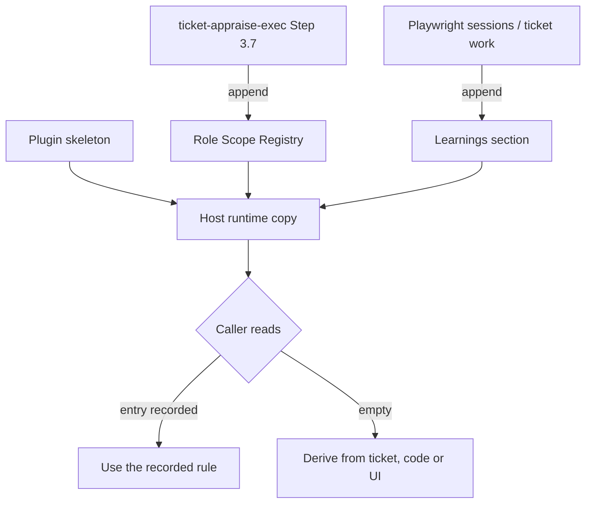

# app-knowledge

> Reference knowledge base for the project app's business rules, user roles, UI behaviour, and system conventions, built up during ticket work. Use this as a lookup when browsing the site via Playwright or when reasoning about role-based behaviour. Not an interactive skill -- read this file directly when you need context about how the app works. Companion: /nav-hints for click-by-click navigation paths.

## What it does

Holds one project's app knowledge: roles, state mappings, navigation patterns and quirks learned during Playwright sessions and ticket work. The plugin ships only a skeleton (environment URL placeholders, an empty `## Role Scope Registry` section and the append contract). The pipeline reads and writes the host's runtime copy at `~/.claude/skills/app-knowledge/SKILL.md`, which may be empty, so callers never assume it holds role rules. `install.sh` never offers to archive that copy.

## Trigger

**Slash command:** None -- read the SKILL.md file directly as a reference lookup.

**Natural language:** (loaded automatically by ticket-verify and ticket-reproduce)

## Inputs

| Input | Source | Required |
|-------|--------|----------|
| (none) | Read-only reference file | N/A |

## Outputs / Artifacts

| Artifact | Location | Description |
|----------|----------|-------------|
| Role Scope Registry entries | `~/.claude/skills/app-knowledge/SKILL.md` | Appended by ticket-appraise-exec Step 3.7 |
| Learnings | `~/.claude/skills/app-knowledge/SKILL.md` | Appended below "Append new learnings below this line" |

## How it works

## Related skills

- [`/nav-hints`](nav-hints.md) -- click-by-click navigation paths (companion reference)
- [`/ticket-verify`](ticket-verify.md) -- uses app-knowledge to interpret snapshots and navigate
- [`/ticket-reproduce`](ticket-reproduce.md) -- uses app-knowledge to derive reproduction steps
- [`/ticket-appraise-exec`](ticket-appraise-exec.md) -- appends Role Scope Registry entries
