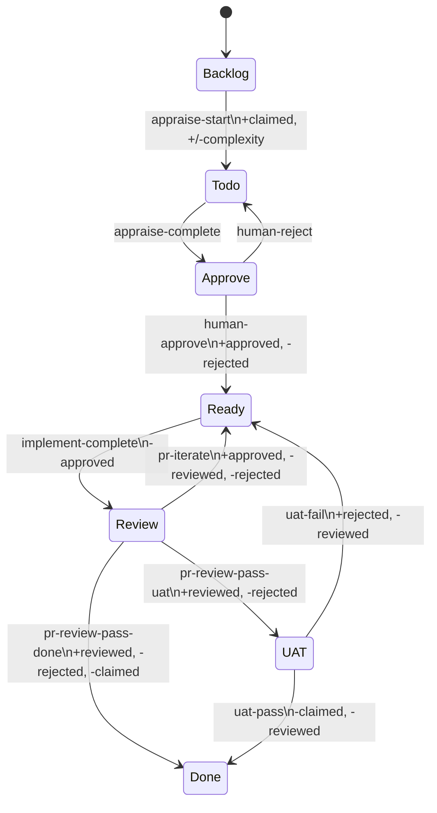

# ticket-flow

> ticket-flow

**Private helper** -- not intended for direct invocation. Called internally by every pipeline skill that changes a ticket's workflow state.

## What it does

Local workflow state machine. Wraps the deterministic `flow.sh` bash script which reads the state machine definition from `workflow.json`, computes the desired end state from the ticket's local manifest plus requested additions and removals, writes it to the manifest and emits one outbox event. `flow.sh` does no tracker I/O: a board driver (`lib/board-drivers/linear.sh`) projects the outbox to Linear later, best-effort. There is no post-trigger assertion any more (exit 7, `STATE_ASSERTION_FAILED`, is retired). Every pipeline skill delegates state transitions and label changes here -- no skill calls Linear mutation endpoints directly.

## Trigger

**Slash command:** `/ticket-flow <TICKET-ID> <TRIGGER> [--data key=value] [--dry-run]`

**Natural language:** (called programmatically by other skills)

## Inputs

| Input | Source | Required |
|-------|--------|----------|
| Ticket ID | CLI argument | Yes |
| Trigger name | CLI argument (e.g. appraise-start, implement-complete) | Yes |
| --data | CLI (trigger-specific values like complexity=simple) | No |
| --dry-run | CLI (preview without mutation) | No |
| LINEAR_API_KEY | Environment variable | Optional: used by the outbox drain's board projection to Linear; flow.sh itself does no tracker I/O |
| workflow.json | Plugin directory | Yes |

## Outputs / Artifacts

| Artifact | Location | Description |
|----------|----------|-------------|
| Manifest transition | Ticket's local manifest | `stage`, `flags`, `rev` and `pending_event` written per state machine rules |
| Outbox event | Per-ticket log dir, `{tid}-outbox.jsonl` | Exactly one event appended per invocation |
| Board projection | Linear (best-effort) | `lib/board-drivers/linear.sh`, run by `outbox-drain.sh` at every flow.sh exit and by fleetd's pusher, sets the column, at most four human-signal labels (`needs-info`, `needs-adr`, `rejected`, `reviewed`) and the assignee on appraise-start. A failure never fails the transition |
| Sentinel file | ~/.claude/state/ticket-flow/validated-{TEAM_ID} | Config validation cache |

## How it works

## Related skills

- [`/ticket-auto`](ticket-auto.md) -- orchestrator that calls flow.sh at multiple dispatch points
- [`/ticket-appraise`](ticket-appraise.md) -- calls appraise-start trigger
- [`/ticket-appraise-exec`](ticket-appraise-exec.md) -- calls appraise-complete trigger
- [`/ticket-implement`](ticket-implement.md) -- calls implement-outcome and implement-complete
- [`/ticket-verify`](ticket-verify.md) -- calls uat-pass, uat-fail, and implement-complete
