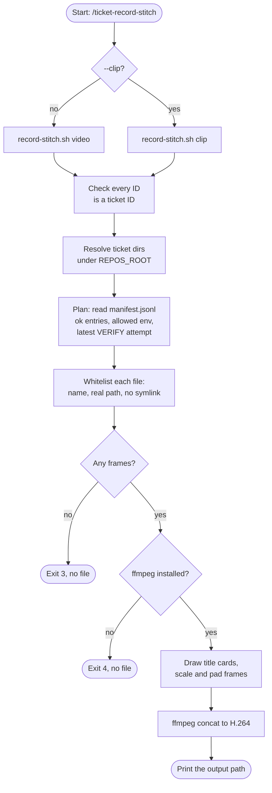

# ticket-record-stitch

> Builds a video from the recordings of one or more tickets that ran with `--record` — a title card per ticket, then its board and app frames in time order. Use when the user says "/ticket-record-stitch {ID}", "stitch the recording for {ID}", "make the video for {ID}", or "build the demo video".

## What it does

`ticket-record-stitch` turns the frames a recording run saved under each ticket's `artifacts/recordings/` into one MP4. It is a thin wrapper around `lib/record-stitch.sh`: a bash/jq planner reads each ticket's `manifest.jsonl` and decides which frames go in, and a small runner hands that plan to `ffmpeg`. It is not a pipeline phase: it writes no pipeline log line, moves no ticket, and can be re-run at any time from what is on disk.

The planner, not the caller, decides what is shown: only `ok` entries, only frames from an environment `RECORD_ALLOWED` allows at stitch time, only the latest VERIFY attempt, and only files whose names and real paths sit inside that ticket's own `artifacts/recordings/`.

## Trigger

**Slash command:** `/ticket-record-stitch <ID>... [--out FILE] [--order given]` or `/ticket-record-stitch --clip <ID>`

**Natural language:** "stitch the recording for <ID>", "make the video for <ID>", "build the demo video"

## Inputs

| Input | Source | Required |
|-------|--------|----------|
| Ticket ID(s) | Arguments | Yes |
| `--out FILE` | Argument (video only) | No |
| `--order given` | Argument (video only; default is by first frame time) | No |
| `--clip` | Argument (one ticket's verification clip) | No |
| `REPOS_ROOT` | Environment, else `./CLAUDE.md` | Yes |
| `RECORD_ALLOWED` (+ `RECORD_UAT_SYNTHETIC`) | Environment, else `$REPOS_ROOT/CLAUDE.md` | Yes |
| `artifacts/recordings/manifest.jsonl` and its frames | Each ticket's workspace | Yes |
| `context.md` | Each ticket's workspace (title card text) | No |
| `ffmpeg` | PATH | Yes |

## Outputs / Artifacts

| Artifact | Location | Description |
|----------|----------|-------------|
| Video | `./recording-<ID>.mp4` (`./recording-<ID>-plus<N>.mp4` for several tickets), or `--out` | Per ticket: a 2 s title card, then board frames (2 s) and app frames (1.5 s) in time order; 1280×800, H.264 |
| Clip (`--clip`) | `<ticket dir>/artifacts/recordings/<ID>-verify.mp4` | The latest VERIFY attempt's app frames, 1.5 s each |
| Output path | Stdout | Printed on success |
| Exit code | Process | 2 usage or bad ID, 3 nothing to stitch, 4 no `ffmpeg`, 5 `ffmpeg` failed; no file is written on 3–5 |

## How it works

## Related skills

- [`/ticket-auto`](ticket-auto.md) — `--record` turns recording on for a ticket
- [`/ticket-verify`](ticket-verify.md) — saves the app frames this skill stitches
- [`/ticket-env-check`](ticket-env-check.md) — reports `RECORD_ALLOWED`
