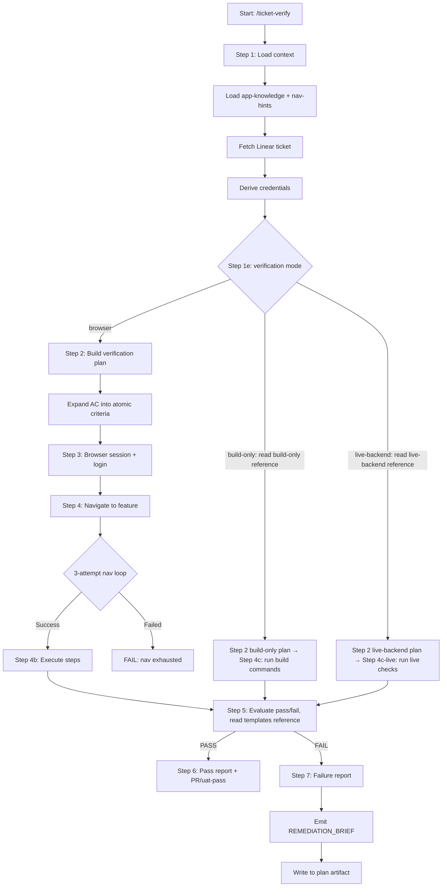

# ticket-verify

> Verifies a Linear ticket fix by loading its requirements, then navigating the live app via Playwright (browser tickets), running the project's build tooling (build-only tickets — e.g. parent-POM/dependency-management changes with no UI or API surface), or checking a running backend directly via health/API calls (live-backend tickets — e.g. service registration, circuit breaker behaviour — a live system with no UI to click), reproducing the original issue steps, and confirming the fix works. Produces a structured pass/fail report. On failure, emits a REMEDIATION_BRIEF that can be fed directly to ticket-implement or a fix skill. Use when the user says "/ticket-verify {ID}", "verify ticket {ID}", "test ticket {ID}", or "check if {ID} is fixed". Accepts optional --user, --password, and --env flags.

## What it does

Performs end-to-end browser verification of a ticket fix using Playwright. Loads the ticket's acceptance criteria from Linear, expands compound requirements into atomic pass criteria, derives the navigation path using nav-hints and app-knowledge (never `page.goto()` for in-app nav), logs into the app, executes click-by-click steps through the UI, evaluates each criterion, and produces a structured pass/fail report. On local pass, opens a PR and moves to Review. On UAT pass, moves to Done. On failure, emits a REMEDIATION_BRIEF with SUGGESTED_FIX, diagnostics, and context files, and writes a Verification section to the plan artifact.

Step 1e picks one of three verification modes with `lib/verify-mode.sh` (gate-check's Check 2.6 classifier lives in the same file). The classifier first finds the ticket's shape (`browser`, `api-only`, `diff-only`, `build-only`, `live-backend`): an explicit `Verify mode: <shape>` field in the ticket wins, negated phrases ("No screen", "no login"), paths, code and "open the PR" are not browser signals, and a ticket that says "No screen" or "API only" is a browser ticket only when it also clicks or navigates. An `api-only` ticket runs the live-backend path and a `diff-only` ticket (docs-only, git-only) runs the build-only path with file and diff checks; the script prints `VERIFY_SHAPE=` for those two. **browser** (the default) drives the app with Playwright as above. **build-only** runs the project's build commands instead (e.g. a parent-POM or dependency change with no UI or API surface). **live-backend** checks a running backend through health and API calls (e.g. service registration or circuit-breaker behaviour). The build-only and live-backend steps (their Step 2 plan variant, Step 4c / 4c-live and their Step 7a diagnostics) live in `skills/ticket-verify/references/build-only.md` and `references/live-backend.md`. Step 1f reads only the file for the detected mode, also on a `--from-step` resume, and a browser run reads neither. The report and Linear comment templates live in `references/templates.md`, which Step 5 reads just before the pass or failure report. The REMEDIATION_BRIEF stays in SKILL.md; the verdict is recorded with `verify_record_verdict` (`lib/verifier-result.sh`), which maps the mode to the verifier id, and the brief's plan section is appended by `lib/remediation-append.sh`. `lib/uat-policy-guard.sh` refuses `--env uat` for a child of an epic with `UAT Policy: epic`.

**Recording (`--record`).** When recording is on for the ticket (`record.sh enabled` on its pipeline log) and the mode is browser, Step 1h reads `references/record.md`. The agent then fixes the viewport at 1280×800 before the first navigation and, each time a step has settled, takes one extra screenshot and hands it to `lib/record.sh append` with the page's URL. `record.sh` decides whether that page's environment may be recorded, names the file and lists it in `artifacts/recordings/manifest.jsonl`. A step whose form holds a typed password gets no frame. A failed screenshot or `append` is ignored: recording never changes the verdict, the report or the pipeline log. [`/ticket-record-stitch`](ticket-record-stitch.md) turns the frames into a video.

**QA persona (`VERIFY_QA_PERSONA`, default `false`).** With the flag on, Step 1g runs `persona-select.sh --phase verify --verify-mode <mode>` after the mode is known and before the plan, logs `META|persona-select`, and reads the `qa-engineer` persona with the `qa/playwright-web` (browser) or `qa/api-testing` (live-backend) specializer; build-only gets no specializer. The steps live in `references/qa-persona.md`. The persona widens the plan, not the verdict: Step 2 may add up to three supporting checks per acceptance criterion (negative path, edge value, state left behind, regression), twelve in total, each naming its criterion. A supporting check that shows its criterion is not met fails that criterion. Anything else it finds goes to an `Observations` report section, which never changes the verdict, never enters the REMEDIATION_BRIEF and never causes a state transition. A selector error or a missing persona file is a `META|persona-select|warn` and the run continues with no persona. With the flag off, the skill behaves as before.

**Criterion tags (`VERIFY_AC_TAGS`, default `false`).** A `ticket-body-v2` criterion starts with `[unit]` (only an automated test can prove it) or `[live]`. With the flag off the tags are ignored and every criterion is proved live. With the flag on, Step 1i runs `lib/verify-ac-tags.sh gate`; when the environment is `local` and the ticket has at least one `[unit]` criterion it reads `references/ac-tags.md`. The agent then keeps the tag on every expanded item, names the test that asserts each `[unit]` item (from the criterion, else by reading the branch's tests), and after the live items calls `verify-ac-tags.sh run` once per repository. The helper, not the agent, learns the test command (`BE_TEST_RUNNER`, else `BE_TEST_CMD`, for a repository listed in `BE_SERVICES`; `FE_TEST_CMD` for any other; with no `BE_SERVICES`, the one side that is configured), runs it in the repository's verify worktree (created at the pushed branch tip when the mode made none), and judges each named test from that run alone: a JUnit XML report written during the run, else, when the run wrote none, the name on an output line of a run that exited 0. **One rule for everything else:** a `[unit]` item with no named test, no learnable test command, no worktree, or a test that failed, was skipped or is not in the run's results **fails**. It is never proved live instead, because the tag says a live attempt cannot prove it, and never passed on notes, PR text or an earlier run. `[live]` and untagged criteria are unchanged, `[unit]` items count in `criteria_met` / `criteria_total`, and reports say `live` or `unit: <test>` per criterion. Limits: `--env uat` ignores the tags; a browser ticket whose criteria are all `[unit]` still starts the stack (`verify-mode.sh` is unchanged); a run is bounded by `VERIFY_AC_TAGS_TIMEOUT` (seconds, default 900). The log is `artifacts/verify-unit-<repo>.log`.

## Trigger

**Slash command:** `/ticket-verify <ID> [--user <email>] [--password <pw>] [--env local|uat] [--from-auto] [--no-env-start]`

**Natural language:** verify ticket <ID>, test ticket <ID>, check if <ID> is fixed

## Inputs

| Input | Source | Required |
|-------|--------|----------|
| Ticket ID | CLI argument | Yes |
| --env | CLI (local or uat, default: local) | No |
| --user | CLI (login email override) | No |
| --password | CLI (password override; otherwise `UAT_TEST_PASSWORD` env or CLAUDE.md field — no built-in default) | No |
| LINEAR_API_KEY | Environment variable | Yes |
| LOCAL_URL | CLAUDE.md | Yes (for --env local) |
| UAT_URL | CLAUDE.md | Yes (for --env uat) |
| REPOS_ROOT | env, ticket env file, or CLAUDE.md (`verify_env_init`) | Yes (for --env local) |
| VERIFY_SERVED_PORTS | env or CLAUDE.md — extra ports/URLs that must serve the ticket's code | No |
| nav-hints.md | TICKETS_ROOT | No |
| app-knowledge | Skill reference | No |

## Outputs / Artifacts

| Artifact | Location | Description |
|----------|----------|-------------|
| Verification report | stdout + Linear comment | Pass/fail with criteria table + diagnostics |
| REMEDIATION_BRIEF | stdout + plan artifact | Structured failure context for re-implementation |
| Verification #N section | Plan artifact | Persisted brief for ticket-implement to read |
| PR (local pass) | GitHub | PR created against develop |
| State transition | Linear | implement-complete (standalone local pass only — the ticket-auto router owns it under `--from-auto`), uat-pass, or uat-fail |
| Nav hint | TICKETS_ROOT/nav-hints.md | New navigation path (if discovered) |

## How it works

## Serving the ticket's own code (local env)

For `--env local`, VERIFY must test the ticket's branch, not whatever the primary checkout under
`REPOS_ROOT` has checked out. One call, `lib/verify-env-up.sh up` (Steps 1.6a3 to 1.6c), takes the
single-flight verify lock, then does the three pieces below (`lib/verify-worktree.sh`), starts the
stack and loads test-data seeds. It releases the lock on every failure and on SIGTERM/SIGINT; on
success the lock stays held until Step 5.

1. **Isolated worktree** (Step 1.6a4): `ensure_verify_worktree` checks out the ticket's pushed
   branch at `REPOS_ROOT/.verify-worktrees/<repo>/<TICKET_ID>`, under the single-flight verify lock.
2. **Hand-off to `env-start.sh`** (Step 1.6b): in the process that runs the project's
   `env-start.sh`, `verify_env_init` resolves `REPOS_ROOT` and `verify_worktree_exports` exports
   `VERIFY_TICKET_ID` and one `VERIFY_REPO_PATH_<REPO>` per worktree (repo name upper-cased,
   other characters mapped to `_`).
3. **Served-checkout check** (Step 1.6b): for `LOCAL_URL`'s port and each `VERIFY_SERVED_PORTS`
   port, the listening process's cwd (`/proc/<pid>/cwd`, `lsof` fallback) is resolved to a git
   checkout and compared with the worktrees. Another checkout of a repo under test on a different
   commit, or with uncommitted changes, gate-stops `VERIFY_SERVED_WRONG_WORKTREE`. The check passes
   only when `LOCAL_URL`'s own port serves the ticket's code. If it cannot tell, it writes a
   `VERIFY_SERVED_UNVERIFIED` gate-warn and verify goes on. `VERIFY_SERVED_WORKTREE_STRICT=true`
   makes that a gate-stop.

**What the project's `env-start.sh` must do** (it lives in the consuming workspace, not in this
plugin):

- For each repo it serves, use `VERIFY_REPO_PATH_<REPO>` when set, else `REPOS_ROOT/<repo>`. Every
  path derived from the repo dir (worker dir, env files, build output) must follow it.
- Restart a service already running from a different directory, instead of skipping it because
  its port is up.
- Optionally, show the served checkout in `env-status.sh` with
  `bash ~/.claude/skills/lib/verify-worktree.sh served <port|url>...`.

`/ticket-env-check` warns when the project's `env-start.sh` does not mention `VERIFY_REPO_PATH`.

## Related skills

- [`/ticket-implement`](ticket-implement.md) -- produces the fix being verified; consumes REMEDIATION_BRIEF on failure
- [`/ticket-flow`](ticket-flow.md) -- state transitions (uat-pass, uat-fail, implement-complete)
- [`/nav-hints`](nav-hints.md) -- click-by-click navigation paths
- [`/app-knowledge`](app-knowledge.md) -- business rules and role-based UI behaviour
- [`/ticket-pr-review`](ticket-pr-review.md) -- PR alignment review triggered after local pass PR creation
